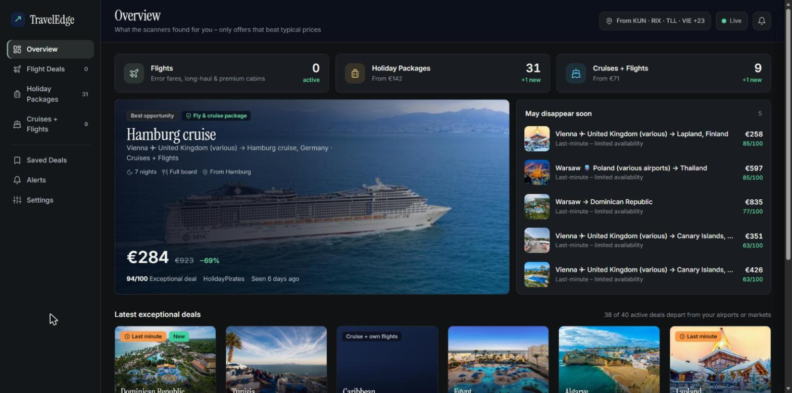
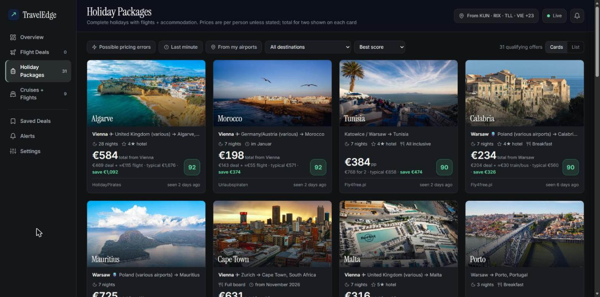
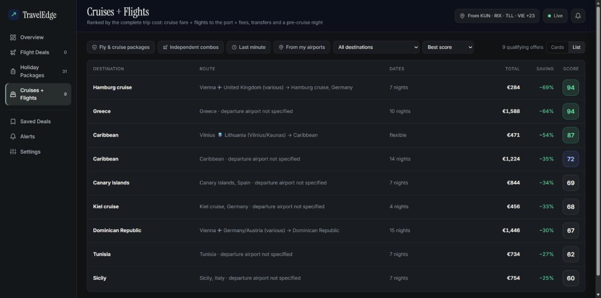
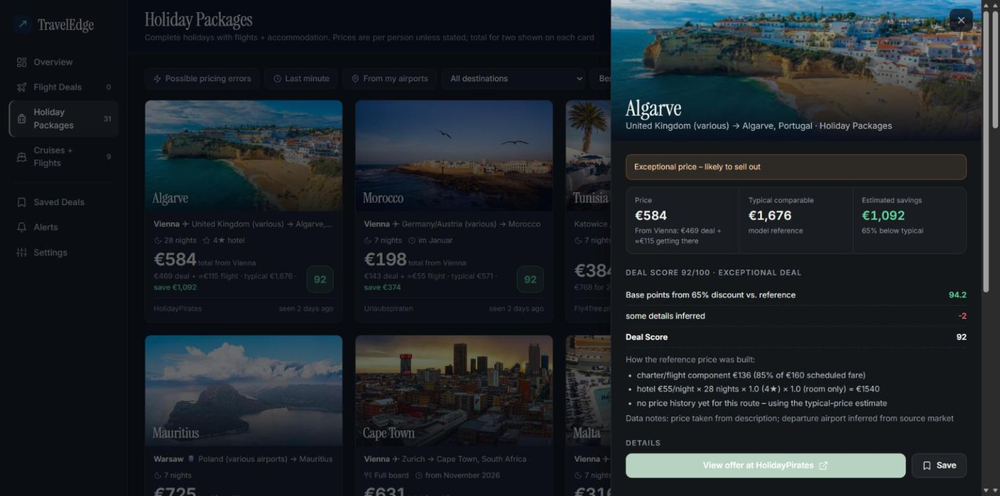

# TravelEdge — automated exceptional travel deal intelligence

TravelEdge is **not** a flight search engine. A background worker continuously scans permitted
European deal sources, normalises every offer, scores it against what that trip *normally* costs,
and surfaces only the genuinely exceptional ones in three categories:

| Category | What qualifies |
|---|---|
| **Flights** | Suspected error fares, extraordinary long-haul discounts, cheap premium cabins, last-minute fares |
| **Holiday Packages** | Flights **+** accommodation only (stand-alone hotels and coach tours are rejected) |
| **Cruises + Flights** | Ranked on the **complete trip cost** — cruise fare + flights to the port + gratuities + transfers + pre-cruise night. Protected fly-&-cruise packages are distinguished from independent combinations |

Error fares and last-minute offers are **filters** across categories, not separate pages.
Nothing is ever booked or purchased automatically.



| Holiday packages, priced from your home airport | Cruises in the compact list view |
|---|---|
|  |  |



<sub>Screenshots show real offers found on 20 Nov 2026; destination photos come from the deal sources and Wikimedia Commons.</sub>

```
Preferences → Automated scanning → Parse & normalise (EUR) → De-duplicate → Price history
            → Deal Score (0-100) → Verification → Dashboard + instant alerts / daily digest
```

---

## Status: what is real, what needs credentials

| Area | Status |
|---|---|
| Live data: 8 RSS deal sources (Fly4free EN/PL, Travel-Dealz, TravelFree.info, HolidayPirates, Urlaubspiraten, Wakacyjni Piraci, Makalius) | ✅ **Implemented & tested with live data** (≈110 real offers per full scan on 13 Nov 2026) |
| Multilingual deal parser (EN/PL/DE/LT/IT) → origin, destination, price, currency, nights, stars, board, cabin, baggage, cruise port | ✅ Implemented, unit-tested on real headlines |
| Currency conversion (ECB daily reference rates) | ✅ Live |
| Deal-scoring engine with transparent breakdown, price history, cross-airport comparison | ✅ Implemented |
| Cruise complete-trip cost model | ✅ Implemented (fees, transfers and hotel are documented estimates) |
| Persistent worker (APScheduler) with per-source intervals, retries, health tracking, expiry, link verification, daily re-scoring | ✅ Implemented & running |
| De-duplication across sources, price-change detection, price history | ✅ Implemented |
| Destination photography (feed images, else Wikipedia/Wikimedia Commons) | ✅ Live |
| Dashboard: Overview, Flight Deals, Holiday Packages, Cruises + Flights, Saved, Alerts, Settings; Cards/List view; phone bottom navigation | ✅ Implemented, responsive |
| Every deal priced from your home hub (Vienna, Vilnius, Warsaw, Riga): train/bus to nearby airports, connecting flight (+ hotel night for long-haul) to far ones, matched to the deal's dates when Travelpayouts is connected | ✅ Implemented (estimates until a Travelpayouts token is added) |
| Alerts: rules by airport / destination region / category / max price / min score / nights / cabin; instant vs daily digest; never sends twice | ✅ Implemented |
| In-app + browser notifications | ✅ Working without setup |
| Telegram, Email (SMTP), ntfy mobile push, webhook | 🔑 Implemented, **needs your credentials** in `.env` (not tested end-to-end here) |
| WhatsApp (Meta Cloud API), Facebook Messenger | 🔑 Implemented against the official APIs, **needs an approved Business/Page app** |
| **Flights:** Aviasales Data API via Travelpayouts — real fares per departure airport, any destination, with dates. Deal blogs are no longer used for flights (`RSS_FLIGHTS=false`) | 🔑 Implemented, **needs a free `TRAVELPAYOUTS_TOKEN`** — not tested without a token |
| **Live airline price check:** Duffel API re-searches the best flight deals (score ≥ 75) with the airlines before alerting; cards show "Live price confirmed" / "Now €X" / "No seats". Alerts skip deals the airline no longer sells at that price. A fresh live price **replaces** the cached one and the deal is re-scored. Defaults: 10 checks/day, score ≥ 85. Duffel is built for booking apps; confirm with Duffel that a search-only monitor is acceptable before using a live token | 🔑 Implemented, **needs `DUFFEL_TOKEN`** — parsing unit-tested, not tested against the live API |
| Tour-operator feeds (Novaturas, Tez Tour, Join UP!, TUI, ITAKA, Rainbow, …) | ⛔ No public API/feed; needs affiliate/partner agreements (see `docs/SOURCES.md`) |
| Demo data | **None.** Everything in the database comes from live sources |

Deliberately **not** built (per product brief): flight search, booking, stand-alone hotel deals,
travel guides, generic destination exploration, generic AI chatbot.

---

## Quick start (local, no Docker)

Requires Python 3.11+.

```bash
python -m venv .venv
```
```bash
.venv/bin/pip install -r backend/requirements.txt          # Windows: .venv\Scripts\pip ...
```
```bash
cp .env.example .env                                         # optional: add credentials
```
```bash
cd backend && ../.venv/bin/python -m app.cli scan           # first scan of every source (≈1 min)
```

Then run **two processes** (the worker keeps scanning when the browser is closed):

```bash
cd backend && ../.venv/bin/uvicorn app.main:app --port 8000
```
```bash
cd backend && ../.venv/bin/python -m app.worker
```

Open http://localhost:8000.

On Windows you can start both hidden with `scripts\start-windows.ps1 -Python .venv\Scripts\python.exe`
and register that script in Task Scheduler ("At log on") so monitoring survives reboots.

> **Windows tip:** if `pip install` fails with a long-path error, create the virtualenv in a short
> path such as `C:\Users\<you>\.venvs\travel-edge`.

### CLI

```bash
python -m app.cli scan [provider]   # run sources now
python -m app.cli verify            # check source links of top offers
python -m app.cli rescore           # recompute scores with latest history
python -m app.cli digest            # send today's digest now
python -m app.cli test-notify inapp telegram email
```

### Tests

```bash
cd backend && python -m pytest -q
```

---

## Deployment

**Docker (recommended).** One small VPS is enough (1 vCPU / 1 GB RAM).

```bash
docker compose up -d --build
```

`api` serves the dashboard on port 8000, `worker` runs the scheduler, both share the `data` volume
(SQLite in WAL mode). For PostgreSQL run `docker compose --profile postgres up -d` and set
`DATABASE_URL=postgresql+psycopg://travel:travel@db:5432/travel_edge` in `.env`.
Supabase works the same way — paste its connection string into `DATABASE_URL`.

Put a reverse proxy with HTTPS in front (Caddy: `reverse_proxy localhost:8000`). The dashboard has
**no authentication** in this MVP — keep it on localhost, a VPN/Tailscale, or behind proxy basic-auth.

**Without Docker:** see `scripts/travel-edge.service` (systemd units for API and worker).

**PaaS:** any host that runs two long-lived processes (Railway, Fly.io, Render background worker +
web service). Serverless/cron-only hosts are not suitable for the worker.

### Estimated monthly cost

| Item | Cost |
|---|---|
| All current data sources (RSS, ECB, Wikipedia) | €0 |
| Travelpayouts Data API | €0 (partner account) |
| VPS (e.g. Hetzner CX22) | ≈ €4–6 |
| Database | €0 (SQLite / Supabase free tier) |
| Telegram, ntfy, email via free SMTP tier | €0 |
| WhatsApp Cloud API | Meta per-conversation pricing (≈ €0.01–0.07 per business-initiated conversation in EU) |
| **Total MVP** | **≈ €5/month** |

The API/cost counters per source are shown in **Settings → Data sources**.

---

## Architecture

```
travel-radar/
├── backend/app/
│   ├── providers.py   source registry (RSS + Travelpayouts API), robots.txt check, unavailable-source list
│   ├── parsing.py     multilingual headline → structured offer
│   ├── geo.py         departure airports, destinations gazetteer, regional reference prices
│   ├── cruise.py      embarkation ports + complete-trip cost model
│   ├── scoring.py     Deal Score + classification (see docs/SCORING.md)
│   ├── scanner.py     pipeline, de-dup, history, expiry, verification, re-scoring
│   ├── notify.py      alert rules, channels, de-duplicated delivery, digest
│   ├── worker.py      persistent scheduler (independent of the dashboard)
│   ├── main.py        REST API + static dashboard
│   └── fx.py, images.py, db.py, config.py, cli.py
├── backend/tests/     parser & scoring tests on real headlines
├── frontend/          dependency-free SPA (HTML/CSS/JS, ECharts for history charts)
├── docs/              SCORING.md, SOURCES.md
├── Dockerfile, docker-compose.yml, .env.example, scripts/
```

**Database tables:** `offers`, `price_history`, `providers`, `scan_logs`, `airports`, `alert_rules`,
`notifications` (unique per rule/offer/channel → no duplicate alerts), `watchlist` (saved deals),
`geocache`, `fx_rates`, `settings`.

**Why APScheduler instead of Celery/Redis:** a single worker process with a thread pool handles
9 sources at 45–120 min intervals with negligible load; it removes Redis from the bill. The scan
functions are plain Python and can be wrapped in Celery tasks unchanged if you scale out.

**Why a no-build frontend instead of Next.js:** zero toolchain, served by the API, works offline on a
VPS, and the whole UI is ~1,000 lines. The REST API (`/api/*`) is framework-agnostic if you later
want a Next.js front end.

### Adding a source

1. RSS: append a `ProviderDef(...)` to `PROVIDERS` in `providers.py` (key, URL, default market, interval).
2. API: write `fetch_<key>(p, origins) -> (items, calls)` returning `RawItem`s — set `structured={...}` to
   skip text parsing — and dispatch it in `scanner.run_provider`.
3. Restart the worker; the provider row and schedule are created automatically.

Only add sources whose terms permit automated access. The fetcher checks `robots.txt` and never
bypasses authentication, CAPTCHAs or bot protection.

---

## Responsible use

* Prices come from third-party publications and can change at any moment; every card links to the
  original source and shows when it was last seen and verified.
* "Error fare" labels are always **suspected**: either the publisher calls it one, or the price is an
  extreme statistical outlier. Airlines may cancel mistaken fares.
* TravelEdge never books, pays, or stores payment data.

---

## License

MIT – see [LICENSE](LICENSE).
